# Electronics labs

I designed digital and analogue circuits in Multisim, then built and measured them on the bench with a Rohde & Schwarz RTB2002 oscilloscope, a bench multimeter and a bench power supply.

## Half adder and full adder timing

I built a half adder in Multisim from 74LS00 NAND gates and 74LS04 inverters, drove it with a word generator and read Sum and Carry on a logic analyser. I used the analyser cursors to measure the propagation delay from the input change to the output change at several word generator rates. The outputs settled about 29 ns after the inputs changed at 10 MHz and about 38 ns at 7 MHz. I then turned the half adder into a subcircuit and built a full adder from two of them and a 74LS32 OR gate, which measured between about 53 ns and 97 ns.

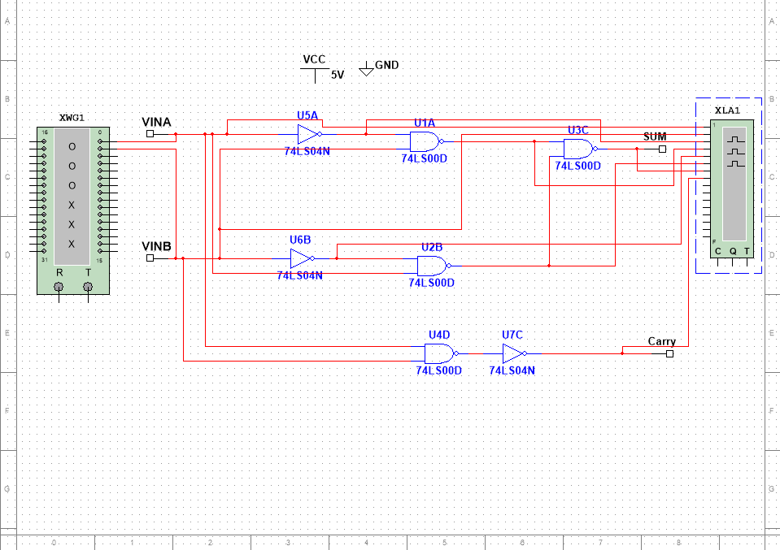

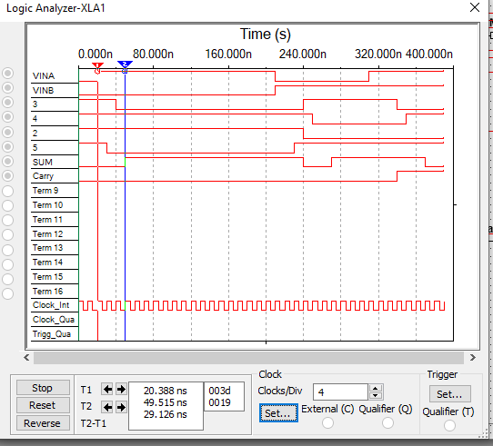

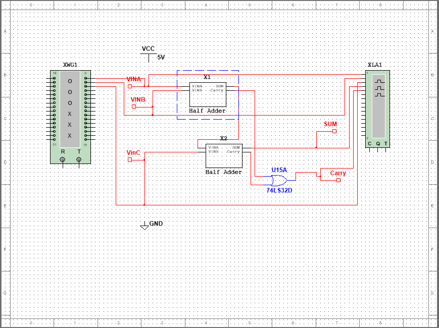

## RS232 serial transmitter

For the second and third digital assignments I designed the transmit side of an RS232 serial link using the multiplexer method. In Multisim, switches set the data bits, 4 bit shift registers hold them, and a counter subcircuit drives the select lines of 4 to 1 and 2 to 1 multiplexers so the bits leave one at a time on a single line. A hex display shows the count and a logic analyser checks the bit sequence. I then wired the design on the lab's standard logic boards with jumper leads and connected an oscilloscope probe to the output.

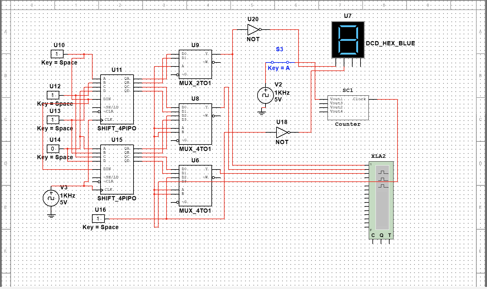

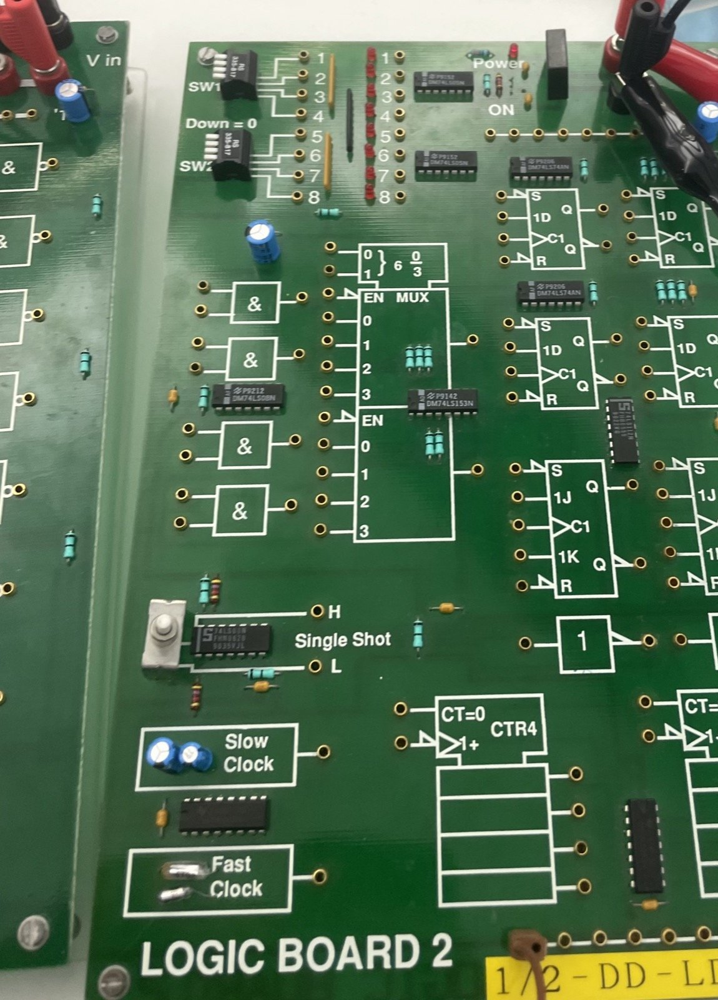

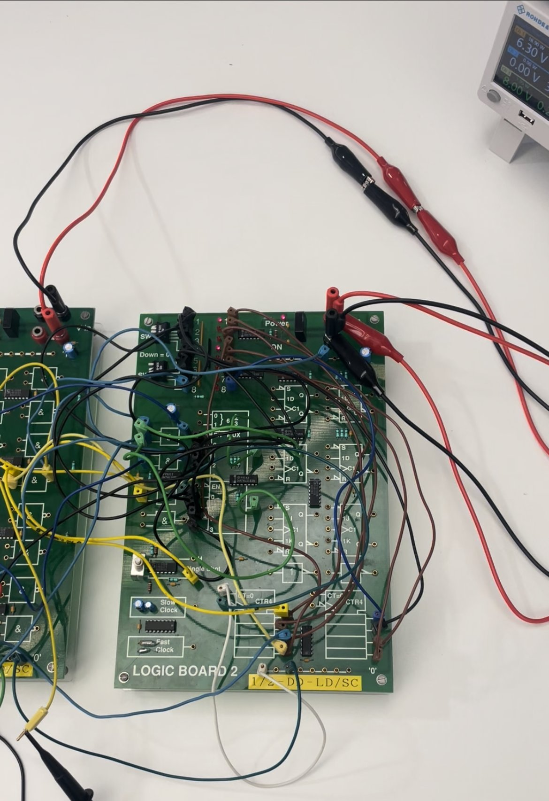

## Resistor networks and the Wheatstone bridge

In my first analogue lab I checked Ohm's law by stepping a resistor box through 15 values from a fixed 10 V supply and logging current and output voltage with a multimeter. I measured a potential divider made from two 33 kΩ resistors, which gave 4.99 V from the 10 V supply. I then balanced a Wheatstone bridge by adjusting one arm until the meter reading was close to zero, which gave the unknown arm as about 8.08 kΩ.

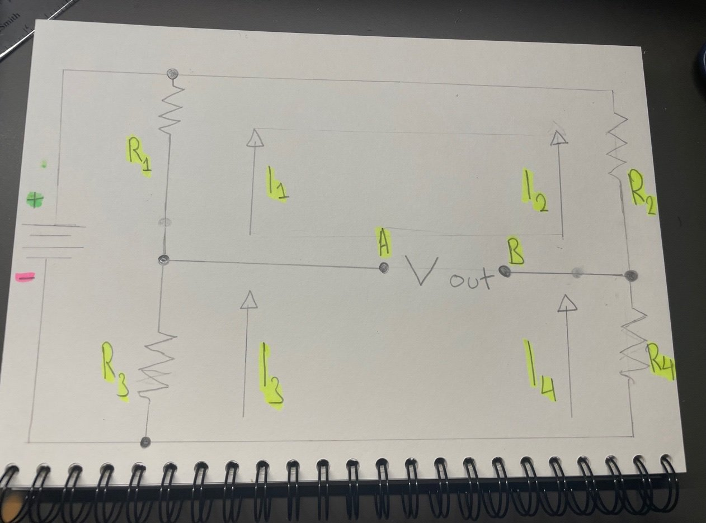

## Measuring capacitance with an op amp integrator

I put a capacitor in the feedback path of an inverting op amp, fed in a 1 kHz, 200 mV peak to peak square wave and watched the triangle wave at the output on the oscilloscope. I used the cursors to read the voltage change over each half period and worked out the capacitance from C = dt × Vin / (Rin × dV). The 8.2 nF capacitor measured 8.9 nF and the 6.8 nF capacitor measured 7.46 nF, both within about 0.7 nF of the marked value.

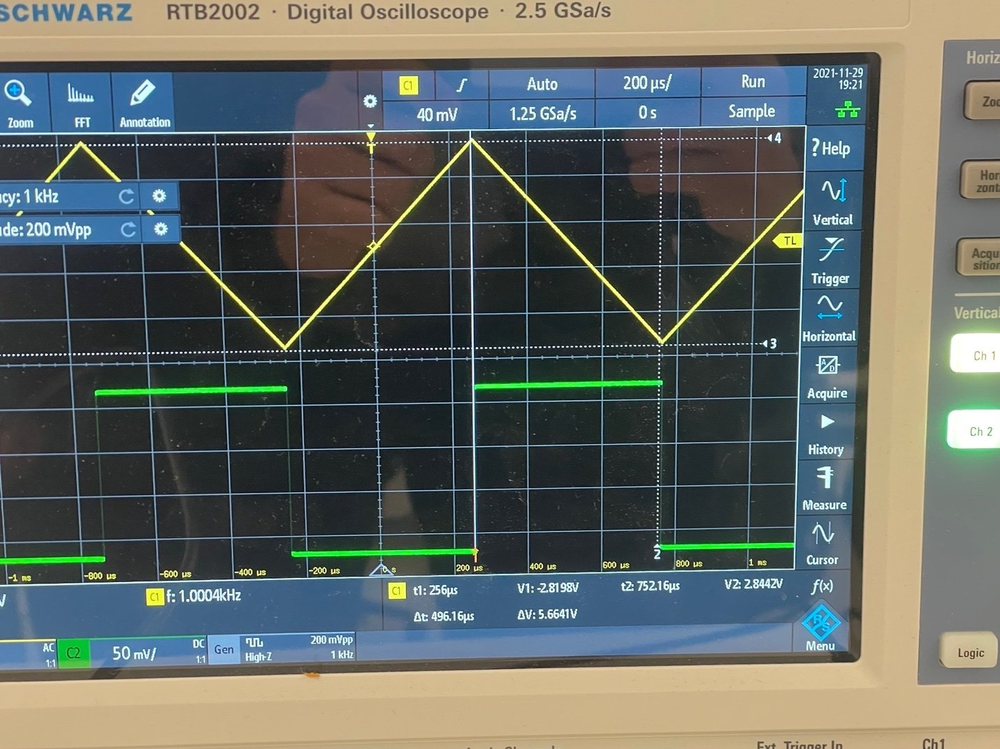

## Transistor amplifier in Multisim

This lab ran in Multisim. I modelled a single transistor amplifier using its small signal model and drove it with a 1 kHz sine wave at 10, 50 and 100 mV peak over a 10 ms simulation. At each level I used Ohm's law to find the ratio of output current to input current, to see how far the linear small signal model and superposition hold for a non linear device.

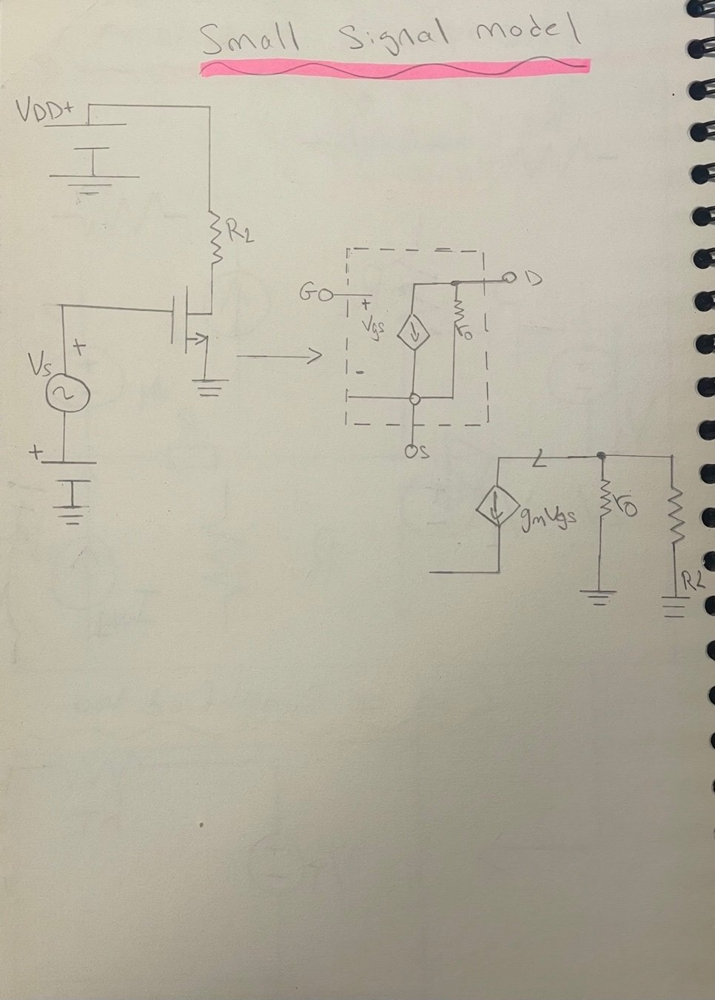

## Transformer and rectifier measurements

In my second electronics module I characterised a mains transformer power supply board stage by stage and kept a dated lab logbook. With no rectifier, the secondary fell from 7.39 V rms with no load to 6.75 V rms at 15 Ω, a regulation of about 9.5 %, and I fitted a line to the readings in MATLAB. With a four diode bridge and an 82 Ω load, adding the smoothing capacitor cut the ripple from 18.9 V to 1.3 V peak to peak and raised the mean output from 10.9 V to 16.2 V. I then swept the smoothed output from open circuit down to 15 Ω and plotted it in MATLAB: the mean fell from 18.9 V to 11.6 V while the ripple grew from 0.73 V to 3.2 V peak to peak.

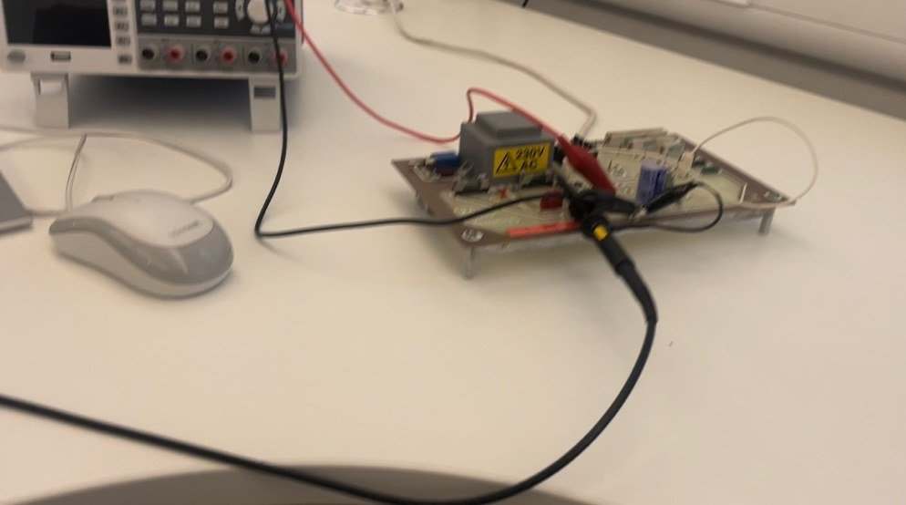

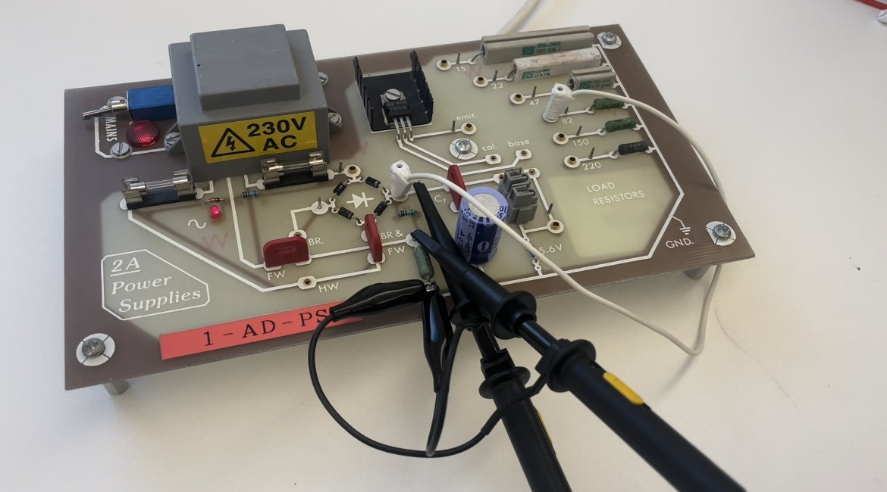

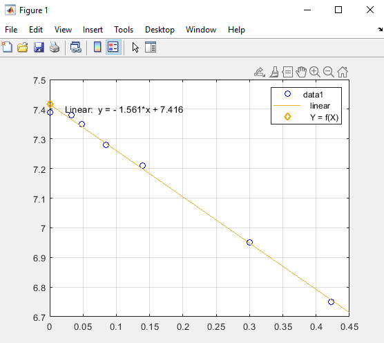

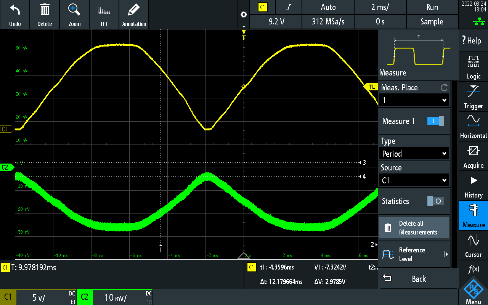

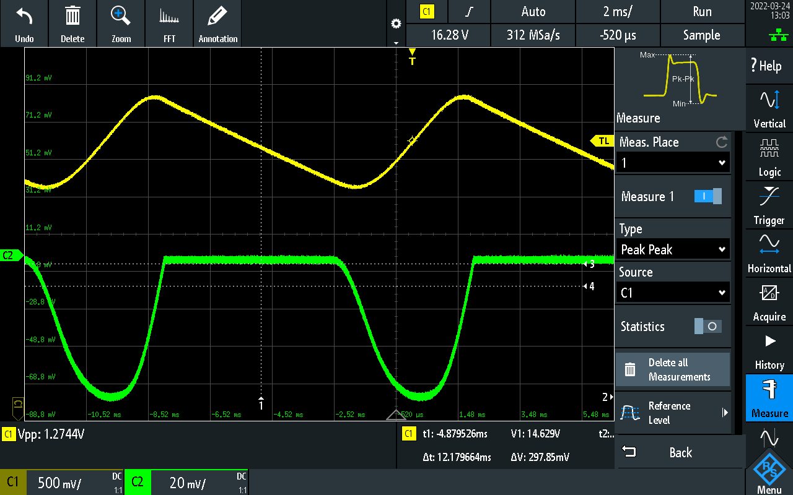

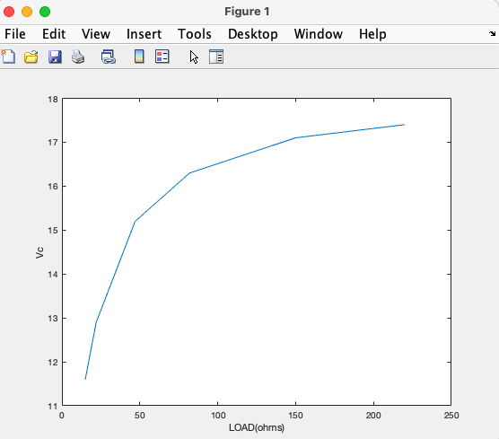

## Partial board regulator comparison in Multisim

I rebuilt the power supply stages on the partial board circuit in Multisim and simulated the transformer output, the two and four diode rectifiers, the smoothing capacitor, a Zener shunt regulator and a transistor series regulator. With a 10 µF capacitor and a 22 Ω load the bridge output had a mean of 8.06 V with 3.52 V of ripple, while the transistor stage showed a mean of 9.49 V with only 85.9 mV of ripple. Of the circuits I simulated, the transistor series regulator gave the steadiest output.

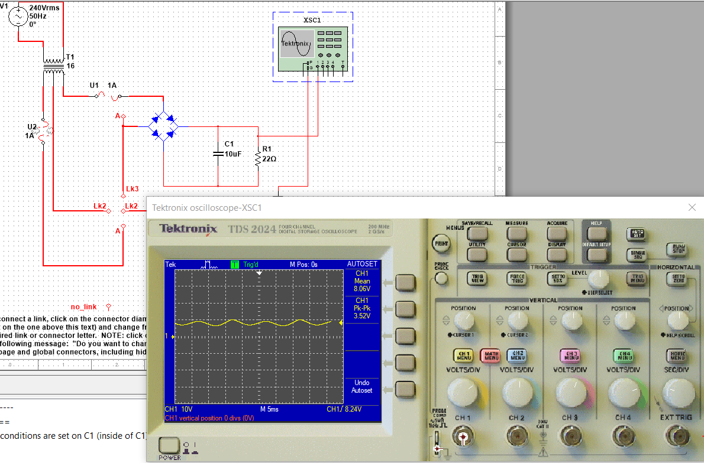

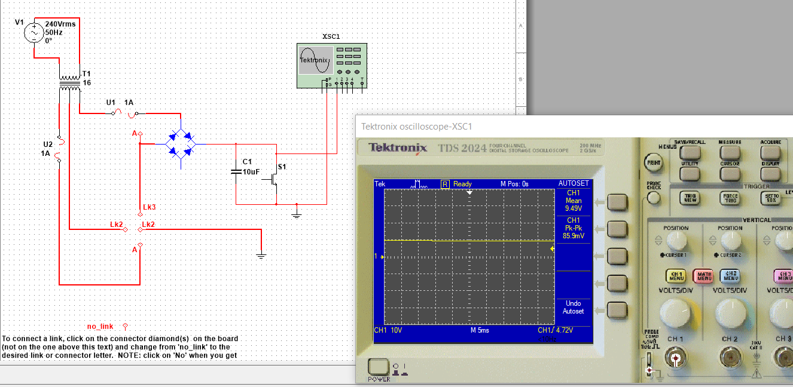

## Skills

Multisim schematic capture and simulation, logic board wiring, oscilloscope and multimeter measurement, logic design with TTL gates, shift registers and multiplexers, propagation delay measurement, op amp circuits, rectifier and regulator circuits, small signal analysis, MATLAB plotting, lab logbook keeping.

Copyright 2026 Mustafa Khodir. All rights reserved. Photos, videos and designs may not be reused without permission.
